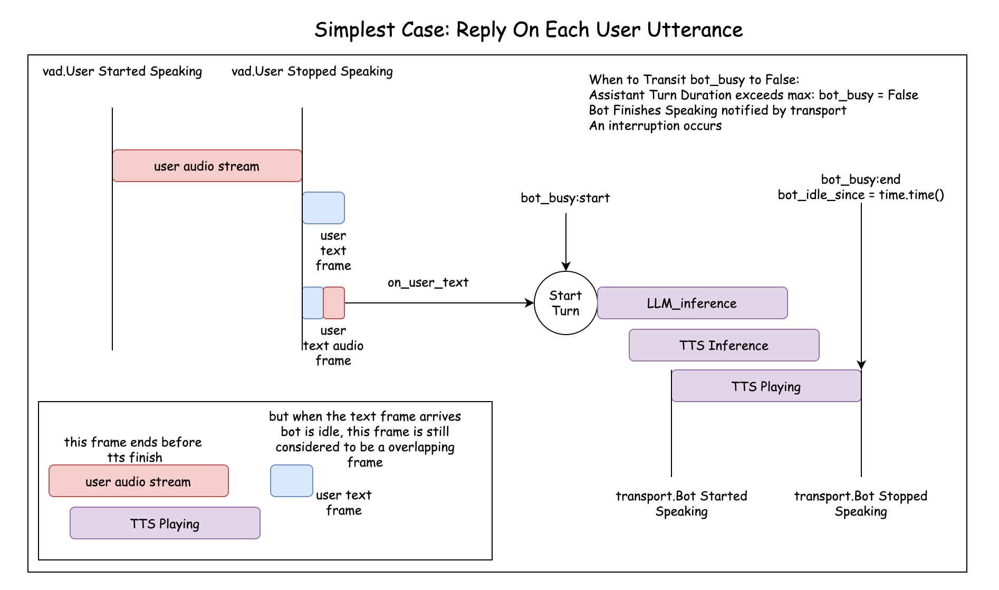
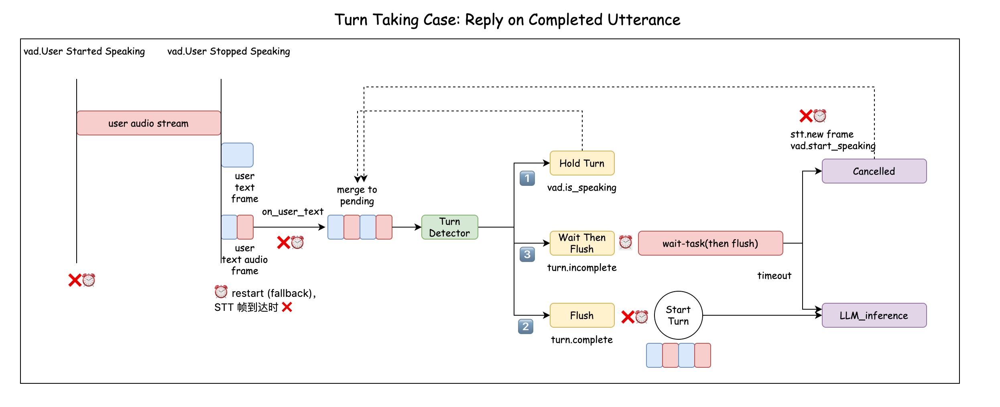

# 轮次管理（turn）：aggregator 是怎么"听"用户的

aggregator 夹在 STT 和 LLM 中间，像一个**会议主持人**：用户说的每一句话都先到它这里，由它决定"这句话现在该不该交给 bot 回答"。

```
STT ──TextAudioFrame──▶ aggregator ──TextFrame──▶ LLM ──▶ TTS ──▶ transport
                          ▲    ▲                                    │
          VAD 广播：用户开口/停口     transport 广播：bot 开口/播完 ◀──┘
```

- **它之前是"用户侧"**：每句话的文字、音频、时间戳都对得上（`TextAudioFrame`）。
- **它之后是"助手侧"**：交给 LLM 时只留文字，音频在这里就丢掉了。

## 主持人脑子里记着什么

都放在一个小本子 `BotState`（`bot_state.py`，纯数据）里，aggregator 用 `self.bot` 访问：

| 状态 | 意思 |
|---|---|
| `bot.busy` | bot 是不是在忙：从把话交给 LLM 那一刻起，到客户端把回复**播完**为止（也可以用 `aggregator.bot_busy`） |
| `bot.speaking` | bot 是不是已经开口了（忙的时候分两段：先"思考"，再"说话"） |
| `bot.turn_id` | bot 正在回答的是第几句话；bot 发来的事件不属于这一轮就不理（`bot.is_current()`） |
| `bot.idle_since` | bot 上一次闲下来的时间，用来判断一句话是不是"抢话"（`bot.overlapped()`） |

## 场景一：一句一回（`DropWhileBotBusyAggregator` / `KeywordInterruptAggregator`）



1. 用户说完一句，STT 把文字送过来。
2. 主持人看一眼：bot 闲着吗？是"闭嘴"吗？是不是抢话？都没问题，就 `start_turn`：bot 变忙，话交给 LLM。
3. bot 思考、合成、播放……transport 估算客户端播完了，广播 `BotStoppedSpeaking`，bot 变闲。

bot 忙的时候用户说的话：

- 包含"闭嘴" → **打断**：广播 `InterruptFrame`，LLM、TTS、transport 立刻停下，bot 马上变闲。
- 其他的话 → **丢掉**。半双工就是这么霸道。

**抢话的判断有个小机关**：STT 有延迟，一句话的文字可能在 bot 已经说完之后才送到。所以不能只看"文字到达时 bot 忙不忙"，还要看"这句话**说完**的时间"（`origin_ts`）是不是早于 bot 闲下来的时间。早于的话，说明用户是在 bot 说话时说的，照样算抢话。

## 场景二：等用户把话说完（`SmartTurnKeywordInterruptAggregator`）



VAD 很急性子：用户停顿 0.2 秒就切一句。于是"我想问一下……那个……明天天气怎么样"会被切成好几段。如果每段都马上回答，bot 就会抢着接话。

所以主持人手里多了一个**草稿本**（`pending_frame`）：每来一句，先 `merge` 到草稿本上，再把草稿本里**所有的音频**交给 smart turn 模型听一听：用户说完了没有？

结果按优先级处理：

| 优先级 | 情况 | 处理 |
|---|---|---|
| ① ⏸️ Hold | 判断的时候用户**已经又开口了** | 不管模型怎么说，先别交，等这段话的文字 |
| ② 🟢 Done | 模型说"说完了" | 把整个草稿本交给 LLM，清空草稿本 |
| ③ 🔴 Not done | 模型说"还没说完" | 定一个短闹钟，等用户继续 |

## ⏰ 两个闹钟

整个 aggregator 里只有两个闹钟，理解了它们，就理解了所有的取消逻辑。

两个闹钟都是同一个小工具 `Alarm`（`alarm.py`）：`start(秒数)` 定上（再定一次会替换掉旧的），`cancel()` 按掉，`armed` 看它是不是在走，响了就调用一次回调。

### 🐕 看门狗：一个"保险长闹钟"（`_watchdog`，默认 120 秒）

每次 `start_turn` 时定上。它的意思是：

> "bot 这一轮最多忙 120 秒。到点了还没人告诉我它闲下来了，我就当它闲了。"

正常情况下 bot 早就播完了，`BotStoppedSpeaking` 一来，主持人就**按掉**这个闹钟（`_set_idle` 里 `self._watchdog.cancel()`）。它只在出事的时候响：比如 TTS 崩了、结束帧丢了。没有它的话，bot 会永远"忙"下去，再也不理用户。

闹钟响的时候还会核对一下：现在忙的还是**定闹钟时的那一轮**吗？如果已经换了一轮，这个旧闹钟响了也不算数。

### ⏳ "再等等"闹钟：一个短闹钟（`_wait`，默认 1.5 秒）

模型说"还没说完"时定上。它的意思是：

> "我再给你 1.5 秒。1.5 秒里你没接着说，我就把草稿本交出去，不让 bot 干等。"

这个闹钟会被**很多人按掉**，这正是它的精髓：

| 谁按掉闹钟 ❌⏰ | 为什么 |
|---|---|
| VAD 说"用户又开口了"（`UserStartedSpeaking`） | 用户在说话呢，别催。等这段话的文字到了再判断 |
| STT 送来了新的一句（`accept_utterance` 开头） | 有新内容了，合并进草稿本，重新判断 |
| 草稿本交出去了（`_flush_pending`） | 已经交了，闹钟没用了 |
| 组件关闭（`cleanup`） | 散会 |

还有一个人会**重新定上**闹钟 ⏰：

| 谁重定闹钟 | 为什么 |
|---|---|
| VAD 说"用户停口了"（`UserStoppedSpeaking`），而草稿本还没交、闹钟也没在走 | **兜底**。正常情况下这段话的文字马上就到，到了会按掉闹钟、重新判断；但如果这段声音其实是噪音（误触发），或者 STT 什么都没识别出来，文字永远不会来。没有这个闹钟，草稿本就永远卡住了 |

一句话总结："**用户在说话，闹钟就不走；用户停下了，闹钟才开始走。**"

### 闹钟响了，事情却已经变了？

主持人请模型判断时要 `await` 一下（第一次还要加载模型，可能要好几秒）。这段时间里，"再等等"闹钟可能已经响过，把草稿本交出去了。等模型的结果回来，草稿本已经不是原来那一本了：

```python
if self.pending_frame is not pending:
    return   # 结果过时了，当没听见
```

不检查的话，就会对一个已经交出去的草稿本再打一次 🟢 / 🔴 日志，甚至定一个永远等不到内容的闹钟。

## 日志里的红绿灯

| 标记 | 意思 |
|---|---|
| 🔴 `TURN NOT DONE ... waiting 1.5s` | 模型说没说完，"再等等"闹钟定上了 |
| ⏸️ `user speaking again, wait paused` | 用户又开口了，闹钟被按掉 |
| ⏸️ `TURN HELD` | 判断出来时用户正在说话，先不交 |
| 🟢 `TURN DONE` | 说完了，交给 LLM |
| `turn complete (no more speech after 1.5s)` | "再等等"闹钟响了，草稿本被交出去 |
| `dropped, bot thinking / bot speaking` | bot 忙，这句话被丢掉 |
| `interrupting reply to #n` | 说了"闭嘴"，打断 bot |

## 类的关系

```
UserUtteranceAggregator             状态 + 看门狗 + start_turn / interrupt_bot / overlapped_bot
└── DropWhileBotBusyAggregator      bot 忙就丢
    └── KeywordInterruptAggregator  + "闭嘴"打断；把"接受一句话"留成钩子 accept_utterance
        └── SmartTurnKeywordInterruptAggregator
                                    + 草稿本、smart turn 模型、"再等等"闹钟、监听 VAD 开口/停口
            └── BargeInAggregator   + 看中间结果插话打断、过滤附和、思考阶段被打断时重新打开上一轮
```

想换一种轮次策略，就继承合适的那一层，重写 `on_user_text`、`accept_utterance` 或 `on_interim_text`。

## 文件

| 文件 | 内容 |
|---|---|
| `aggregator.py` | 上面这几个类 |
| `bot_state.py` | `BotState`：bot 的状态，纯数据 |
| `alarm.py` | `Alarm`：一次性闹钟，看门狗和"再等等"共用 |
| `rules.py` | 纯文字规则：`is_stop_command`、`is_backchannel`、`is_barge_in`，以及停止词、附和字表 |

测试在 `project/tests/test_turn.py`（各个场景）和 `test_turn_parts.py`（上面这几个小零件），运行：`cd project && python -m pytest`。
